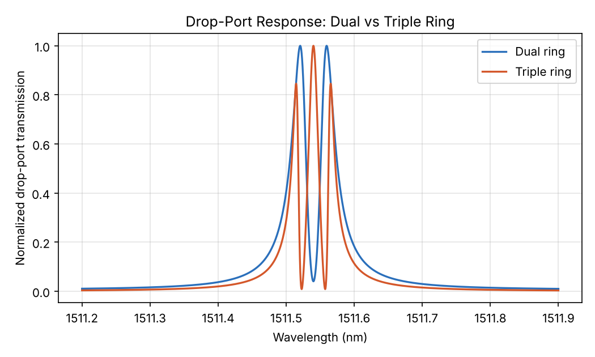
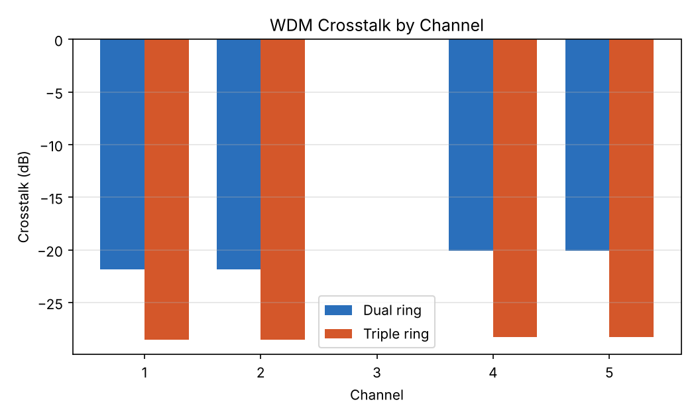
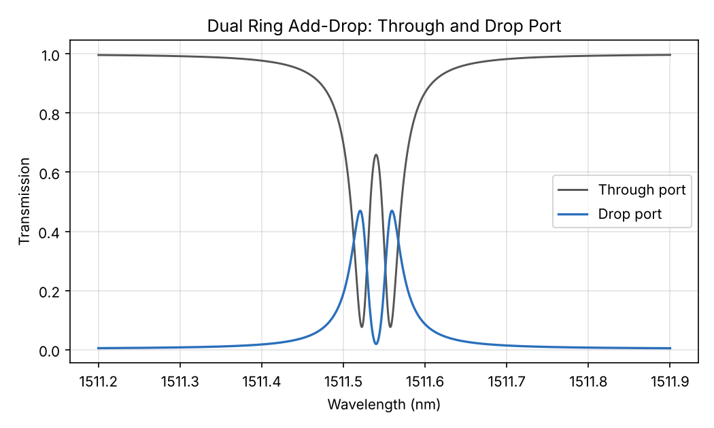
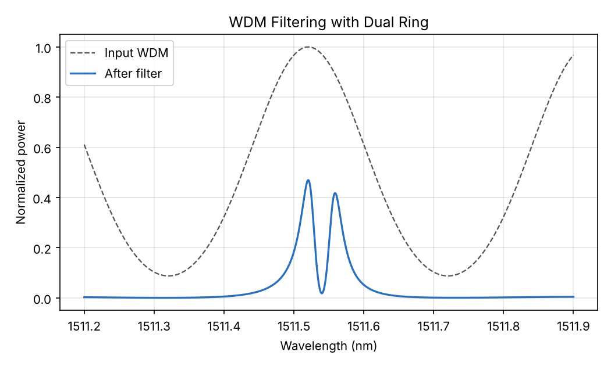
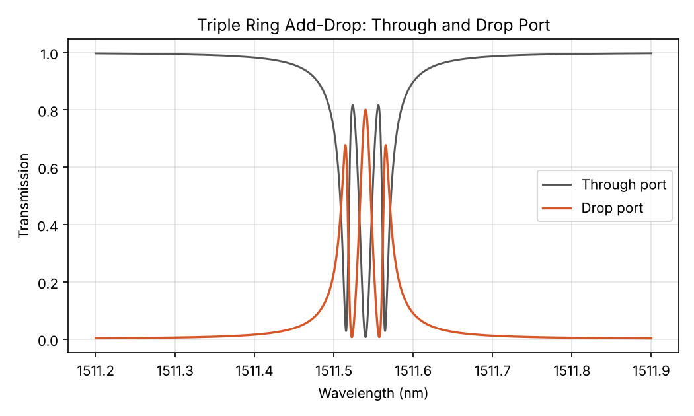
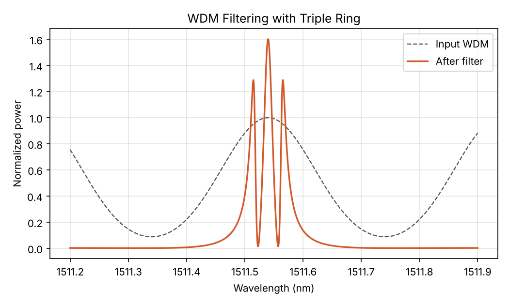

# Topology-Assisted Ring Resonator for DWDM Optical Filtering

Comparative performance analysis of **dual-ring** and **triple-ring** add-drop resonators for wavelength-division-multiplexing (WDM) channel filtering in optical fiber communication systems. Both devices are modelled with **Coupled Mode Theory (CMT)** and benchmarked on a five-channel dense WDM (DWDM) signal with 50 GHz (0.4 nm) spacing centred at 1511.54 nm.

> Course project: Optical Fiber Communications, ECE, VIT Vellore (2025-26)

## Highlights

- Serially coupled rings in an add-drop topology; the number of rings and the inter-ring couplings shape the filter response without changing the waveguide platform.
- Going from two rings to three gives a **~57% higher Q factor**, a **~36% narrower FWHM**, and **6.7-8.2 dB lower adjacent-channel crosstalk**.
- The simulation (3x3 CMT system solved at 200,000 wavelength points) is provided in MATLAB and as an equivalent Python port.

## Results

| Metric | Dual ring | Triple ring | Change |
|--------|-----------|-------------|--------|
| Resonance (nm) | 1511.5206 | 1511.5400 | about the same |
| FWHM (pm) | 25.41 | 16.17 | ~36% narrower |
| Quality factor Q | 5.948 x 10^4 | 9.346 x 10^4 | ~57% higher |
| FSR (nm) | 5.4397 | 5.4399 | theory: 5.44 |
| Crosstalk, channels 1 and 2 (dB) | -21.84 | -28.51 | 6.67 dB better |
| Crosstalk, channels 4 and 5 (dB) | -20.09 | -28.25 | 8.16 dB better |

Raw numbers: [`results/metrics.csv`](results/metrics.csv), [`results/crosstalk.csv`](results/crosstalk.csv).

### Drop-port response and crosstalk

| Drop-port response (normalised) | Crosstalk per channel |
|:---:|:---:|
|  |  |

### Dual ring (2 dB/cm loss, add-port amplitude 0.05)

| Through and drop port | WDM filtering |
|:---:|:---:|
|  |  |

### Triple ring (0.5 dB/cm loss, add-port amplitude 0.02)

| Through and drop port | WDM filtering |
|:---:|:---:|
|  |  |

## Method

For ring `i` with mode amplitude `a_i`, the steady-state CMT system `M · A = B` is solved at each detuning `Δ = ω − ω0`.

Triple-ring system matrix (the dual ring uses the upper-left 2x2 block):

```
M = | jΔ + γi + γe1 + γe2     -jκ12         0      |
    | -jκ12                   jΔ + γi       -jκ23  |
    | 0                       -jκ23         jΔ + γi |

B = [ sqrt(2γe1)·s_in + sqrt(2γe2)·s_add,  0,  0 ]ᵀ
```

- Through port: `s_through = s_in − sqrt(2γe1)·a1`
- Drop port: `s_drop = sqrt(2γe2)·a1 − s_add`
- Intrinsic loss rate `γi = (1 − e^(−αL)) · τ_scale`, with `τ_scale = c / (n_g · L)`
- `Q = λ_res / FWHM` (from the drop-port peak), `FSR = λ_res² / (n_g · L)`
- Crosstalk of channel `i`: `10·log10(P_i / P_desired)` after drop-port filtering, with the centre channel as the desired one

### Parameters

| Parameter | Value |
|-----------|-------|
| Centre wavelength λ0 | 1511.54 nm |
| Ring circumference L | 100 µm (each ring) |
| Effective / group index | 2.42 / 4.2 |
| Propagation loss | 2 dB/cm (dual), 0.5 dB/cm (triple) |
| Bus / drop coupling | 0.01 / 0.01 |
| Inter-ring coupling κ12 = κ23 | 0.02 |
| Add-port amplitude | 0.05 (dual), 0.02 (triple) |
| WDM channels | 5 Gaussian channels, σ = 0.08 nm, 0.4 nm spacing |
| Wavelength sweep | 1511.2 - 1511.9 nm, 200,000 points |

## Project Structure

```
.
├── simulation/
│   ├── matlab/
│   │   ├── dual_ring_add_drop.m     # Dual-ring MATLAB simulation
│   │   └── triple_ring_add_drop.m   # Triple-ring MATLAB simulation
│   └── ring_resonator_cmt.py        # Python port: runs both and writes results/
├── results/                         # Generated figures and tables
├── requirements.txt
└── README.md
```

## Getting Started

### Python (no MATLAB needed)

```bash
git clone https://github.com/Anushka030205/Optical-Ring-Resonator-WDM-Filter.git
cd Optical-Ring-Resonator-WDM-Filter
pip install -r requirements.txt
python simulation/ring_resonator_cmt.py
```

This prints resonance, FWHM, Q, FSR and crosstalk for both devices and regenerates everything in `results/` in a few seconds.

### MATLAB

```matlab
run('simulation/matlab/dual_ring_add_drop.m')
run('simulation/matlab/triple_ring_add_drop.m')
```

## Future Work

- Non-uniform ring circumferences to exploit the Vernier effect for FSR expansion
- Four- and five-ring cascades for flat-top passband engineering
- Thermal tuning of the inter-ring coupling coefficients
- Fabrication and experimental validation on an SOI platform
- Direct-binary-search (DBS) inverse design of the coupling structure

## References

1. Y. Yanagase, S. Suzuki, Y. Kokubun, S. T. Chu, "Box-like filter response and expansion of FSR by a vertically triple coupled microring resonator filter."
2. Y. Hu, T. Wang, W. Zhou, B. Hu, "Creation of low-loss triple-ring optical filter via direct binary search inverse design."
3. F. Bazouband, A. Rahimpour, "Improving the triple coupled ring-resonator performance as an optical filter."
4. W. Suh, Z. Wang, S. Fan, "Temporal coupled-mode theory and the presence of non-orthogonal modes in lossless multimode cavities," IEEE J. Quantum Electron.

## Authors

Anushka Vishal Chandergi

## License

Academic project for the Optical Fiber Communications course.
